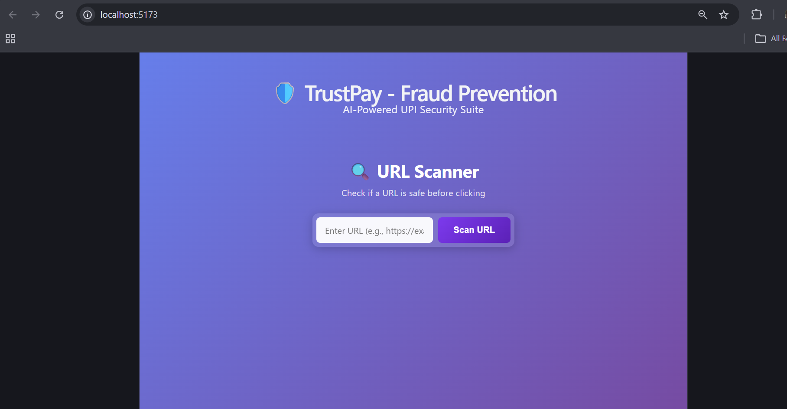
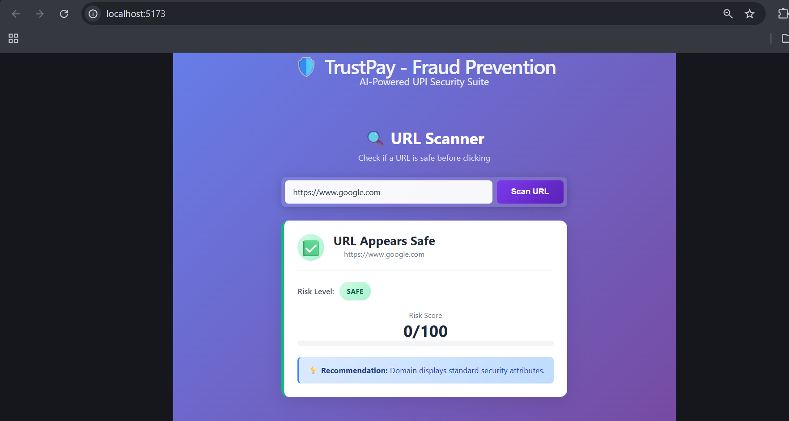
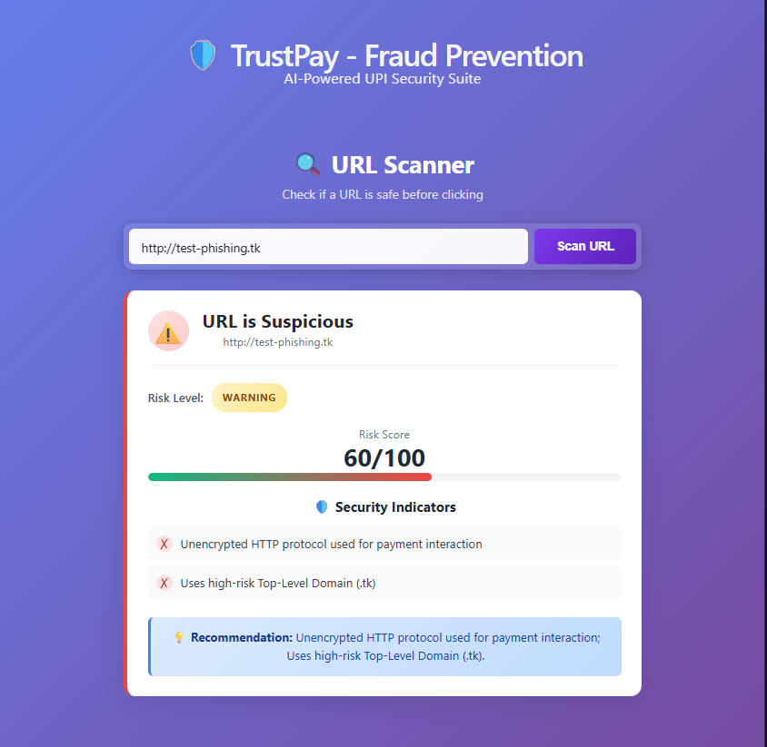

# 🛡️ TrustPay - AI-Powered UPI Fraud Prevention Suite

> An intelligent security platform that protects users from UPI scams, phishing attacks, and fraudulent transactions using real-time threat analysis.

[](https://www.oracle.com/java/)
[](https://spring.io/projects/spring-boot)
[](https://reactjs.org/)
[](https://www.postgresql.org/)
[](https://www.docker.com/)

---

## 🎯 Project Overview

TrustPay is a comprehensive fraud prevention system designed to combat the rising threat of UPI-based scams in India. The platform analyzes URLs, QR codes, screenshots, and transaction patterns in real-time to protect users from phishing attacks, fake payment requests, and fraudulent websites.

### 🚨 The Problem We're Solving

- **₹1000+ crores** lost to UPI fraud in India annually
- **45% increase** in phishing attacks via WhatsApp/SMS
- Users unable to identify fake payment links and QR codes
- No real-time verification tools for suspicious transactions

### ✨ Our Solution

A multi-layered AI-powered security system that provides:
- Real-time URL threat analysis
- QR code security scanning
- OCR-based screenshot fraud detection
- Transaction risk evaluation
- Community-driven scam reporting

---

## 🏗️ System Architecture

```
┌─────────────────┐
│  React Frontend │  ← User Interface (Vite + React 19)
└────────┬────────┘
         │ HTTP/REST
         ↓
┌─────────────────┐
│  Spring Boot    │  ← REST API Layer
│  Backend API    │
└────────┬────────┘
         │
    ┌────┴────┐
    ↓         ↓
┌─────────┐ ┌──────────────┐
│ Security│ │  PostgreSQL  │
│ Engines │ │   Database   │
└─────────┘ └──────────────┘
```

---

## 🛠️ Tech Stack

### Backend
- **Framework:** Spring Boot 3.2.3
- **Language:** Java 17
- **Database:** PostgreSQL 16
- **ORM:** Spring Data JPA / Hibernate
- **Security:** Spring Security, CORS
- **Containerization:** Docker + Docker Compose

### Frontend
- **Framework:** React 19.2.8
- **Build Tool:** Vite 8.3.0
- **HTTP Client:** Axios
- **Styling:** CSS3 with Glassmorphism effects
- **State Management:** React Hooks (useState, useEffect)

### DevOps
- **Containerization:** Docker, Docker Compose
- **Database:** PostgreSQL with persistent volumes
- **Version Control:** Git, GitHub

---

## ✨ Features Implemented

### 1. 🔍 URL Scanner
- Real-time URL threat analysis
- Risk level classification (SAFE / WARNING / BLOCKED)
- Risk score calculation (0-100)
- Detailed security indicators
- Support for HTTP/HTTPS validation
- Detection of suspicious TLDs and patterns

### 2. 🎨 Modern UI/UX
- Purple gradient theme with glassmorphism design
- Responsive layout (mobile + desktop)
- Loading states and error handling
- Smooth animations and transitions
- Color-coded risk indicators

### 3. 🔗 API Integration
- RESTful API architecture
- CORS-enabled cross-origin requests
- Centralized error handling
- Consistent response formatting

### 4. 🐳 Production-Ready Setup
- Dockerized backend services
- PostgreSQL with health checks
- Environment-based configuration
- Easy deployment with docker-compose

---

## 🚀 Getting Started

### Prerequisites
- Docker Desktop
- Node.js 18+
- Java 17+

### Quick Start

1. **Clone the repository**
```bash
git clone https://github.com/bharath260404/trustpay-backend.git
cd trustpay-backend
```

2. **Start the backend**
```bash
docker-compose up -d
```

3. **Start the frontend**
```bash
cd trustpay-frontend
npm install
npm run dev
```

4. **Access the application**
- Frontend: http://localhost:5173
- Backend API: http://localhost:8081/api/v1

📖 **Full setup guide:** See [START_PROJECT.md](START_PROJECT.md)

---

## 📸 Project Screenshots

### 1. URL Scanner Interface

*Clean, modern interface with glassmorphism design — input field, scan button, and purple gradient background*

### 2. Safe URL Analysis (Google.com)

*Real-time scan showing SAFE status with green checkmark, low risk score, and security indicators*

### 3. Suspicious URL Detection

*Phishing URL flagged with WARNING/BLOCKED status, risk factors, and recommendations for user safety*

---

## 🎯 API Endpoints

### Base URL: `http://localhost:8081/api/v1`

| Method | Endpoint | Description |
|--------|----------|-------------|
| GET | `/health` | Backend health check |
| POST | `/url/scan` | Scan URL for threats |
| POST | `/qr/scan` | Analyze QR code security |
| POST | `/ocr/analyze` | OCR-based screenshot analysis |
| POST | `/transaction/evaluate` | Evaluate transaction risk |
| POST | `/report` | Submit scam report |
| POST | `/verify` | Unified threat verification |

---

## 📊 Project Status

### ✅ Completed Features
- [x] Backend REST API setup
- [x] PostgreSQL database integration
- [x] URL Scanner engine
- [x] React frontend with Vite
- [x] CORS configuration
- [x] Docker containerization
- [x] API service layer
- [x] URL Scanner UI component
- [x] Risk assessment display

### 🚧 In Progress
- [ ] Enhanced URL analysis (SSL, domain age, content inspection)
- [ ] QR Code Scanner component
- [ ] OCR Screenshot Analyzer
- [ ] Transaction Risk Evaluator
- [ ] Scam Reporting System

### 🔮 Planned Features
- [ ] Machine Learning-based fraud detection
- [ ] Google Safe Browsing API integration
- [ ] Real-time threat database updates
- [ ] User authentication system
- [ ] Admin dashboard
- [ ] Mobile app (React Native)

---

## 🧪 Testing

### Test the URL Scanner
```bash
curl -X POST http://localhost:8081/api/v1/url/scan \
  -H "Content-Type: application/json" \
  -d '{"url": "https://example.com"}'
```

### Example Response
```json
{
  "inputUrl": "https://example.com",
  "parsedDomain": "example.com",
  "scheme": "https",
  "isIpHost": false,
  "isHighRiskTld": false,
  "containsDeceptiveKeywords": false,
  "riskScore": 0.0,
  "riskLevel": "SAFE",
  "riskFactors": [],
  "warningMessage": null
}
```

---

## 👨💻 Development Journey

This project is being developed as a learning experience, following industry best practices:

- **Version Control:** Git branching strategy (feature branches, no direct commits to main)
- **Code Quality:** Clean code principles, comprehensive comments
- **API Design:** RESTful conventions, consistent error handling
- **UI/UX:** Modern design patterns, accessibility considerations
- **DevOps:** Containerization, environment configuration

---

## 📚 Key Learnings

### Technical Skills
- Full-stack development (React + Spring Boot)
- RESTful API design and implementation
- Docker containerization and orchestration
- Database design with PostgreSQL
- CORS and cross-origin security
- Modern React patterns (Hooks, async/await)

### Development Practices
- Git workflow and version control
- Component-based architecture
- API integration patterns
- Error handling strategies
- Responsive UI design

---

## 🤝 Contributing

This is a personal learning project, but suggestions and feedback are welcome!

---

## 📧 Contact

**Developer:** Bharath  
**GitHub:** [@bharath260404](https://github.com/bharath260404)  
**Project Link:** [TrustPay Backend](https://github.com/bharath260404/trustpay-backend)

---

## 📝 License

This project is developed for educational purposes.

---

## 🙏 Acknowledgments

- Spring Boot documentation
- React documentation
- Docker documentation
- Security research on UPI fraud patterns

---

**Last Updated:** October 14, 2024

**Status:** 🚧 Active Development
